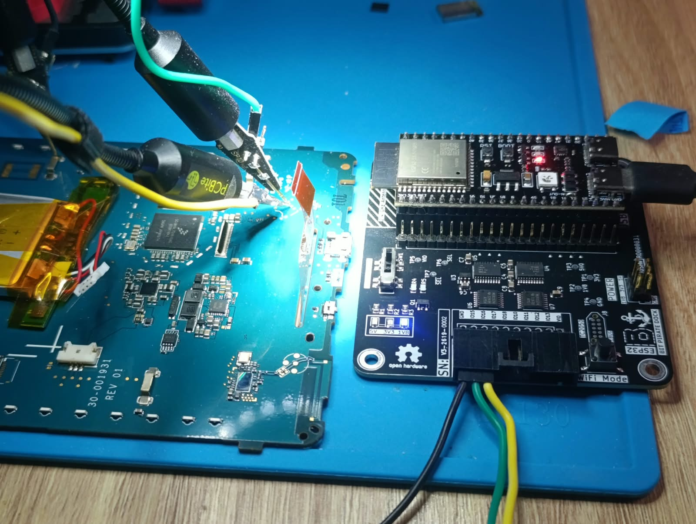
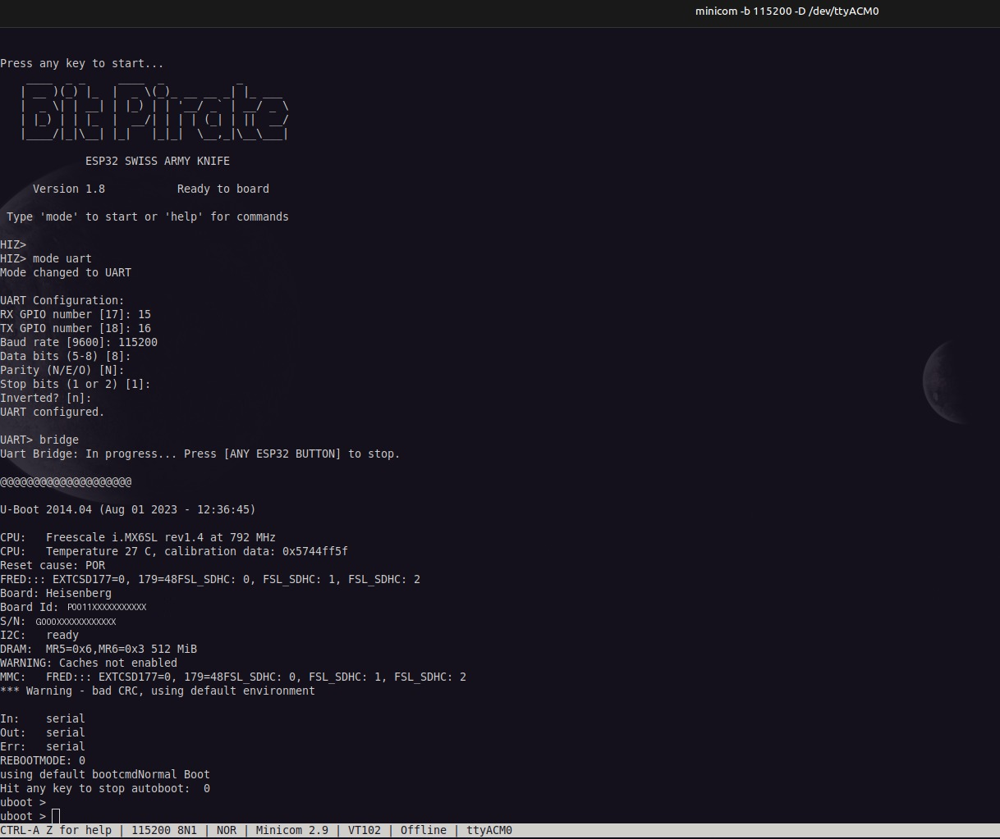
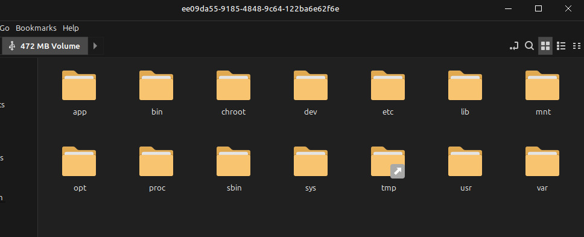
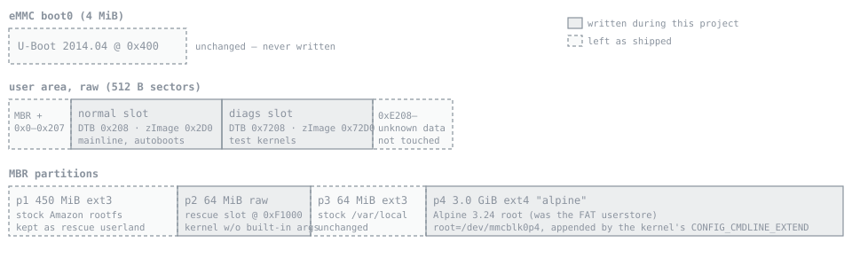
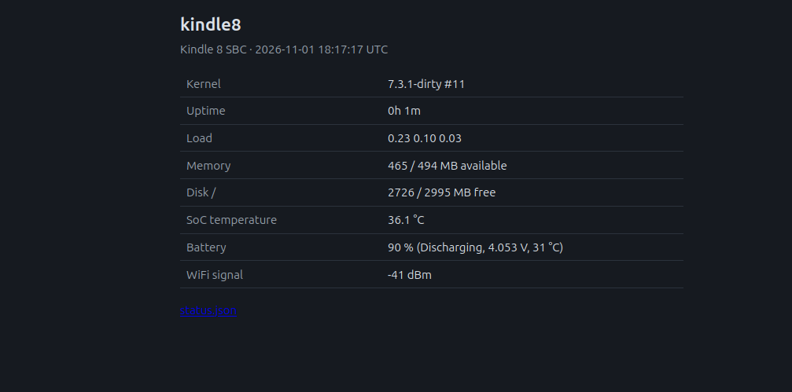
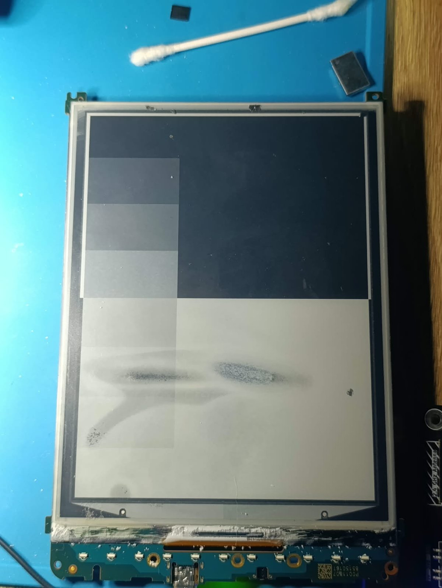
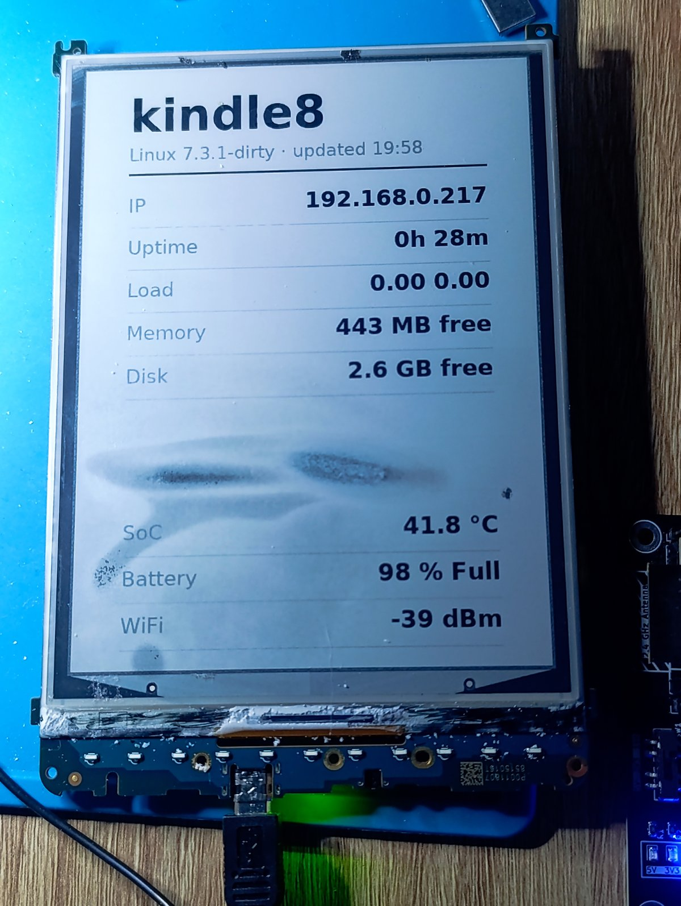
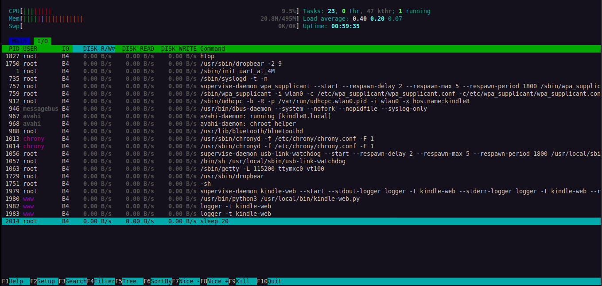

<link rel="stylesheet" href="./css/style.css">
<script src="./js/theme.js" defer></script>

<button id="theme-toggle" type="button" aria-label="Switch to light theme" title="Switch to light theme">🌙</button>

## How this started

I recently got a Kindle 8 with a non-working display. After trying to make it work, I gave up on repairing.
However, I still wanted to tinker with it and make it run in my Frankenstein-homelab, so what better use to have than a pi zero-type of SBC (it only has one core with 512MB RAM).


## Specs of the Kindle 8

A Kindle 8 with a cracked e-ink panel is an i.MX6SoloLite board with 512 MB
of RAM, 4 GB of eMMC, WiFi, Bluetooth and a battery. This write-up covers
replacing Amazon's software on such a unit with a mainline Linux 7.3.1
kernel and Alpine Linux, and using it as a small headless server. Nothing
in U-Boot was modified; all changes are in raw kernel slots and
partitions on the eMMC, and the full original image is kept.

| | |
|---|---|
| Device | Amazon Kindle 8th generation (2016), board "Heisenberg", platform "eanab" |
| SoC | NXP i.MX6SoloLite, single Cortex-A9, PL310 L2 cache (256 KB) |
| Memory | 512 MiB LPDDR2, 3.64 GiB eMMC (Hynix H4G2a) |
| PMIC | ROHM BD71815 (regulators, RTC, charger) |
| Wireless | Broadcom BCM43430/4343W: WiFi on SDIO, Bluetooth on UART |
| Stock software | U-Boot 2014.04, Linux 3.10.53-lab126, firmware 5.16.2.1.1 |
| Result | Linux 7.3.1, Alpine 3.24, WiFi, Bluetooth, battery-backed RTC, battery percentage, e-ink status screen |

Everything here was done over the serial console and the micro-USB port, since the screen couldn't be used to click anything.
Shoutout to the guys at [ebookrepairs.com](https://ebookrepairs.com/kindle-tips/how-can-i-connect-a-serial-port-to-a-kindle/) for making this RE easier on the PCB side.


---

## Serial console and a root shell

While trying out the board, I hooked up my trusty Saleae Logic analyzer to take a look how the board boots up. After establishing the baudrate, I used the [ESP32 Bit Pirate](https://github.com/geo-tp/ESP32-Bit-Pirate) with the [Dock](https://github.com/AndreiVladescu/ESP32-Bit-Pirate-Hardware) in order to to "talk" to the SoC at 1.8V. **Be very careful not to connect a 3.3V to it! It may permanently destroy the SoC!**

The board exposes `ttymxc0` at 115200 8N1 on test pads near the top edge.
It was connected through an ESP32-based Bus Pirate running as a UART bridge,
which shows up on the PC as `/dev/ttyACM0`. Pressing a key during the
three-second countdown stops U-Boot at its prompt.



*The Kindle 8 mainboard (30-001931 REV 01), with PCBite probes on the UART
pads and the ESP32 Bus Pirate dock on the right. The i.MX6SoloLite is the
large chip in the middle, the battery on the left.*

On the Bus Pirate side this is `mode uart` with RX on GPIO 15, TX on GPIO 16,
115200 8N1, followed by `bridge`:



*Bus Pirate set to UART bridge mode, then the Kindle's U-Boot banner and
prompt. Board ID and serial number are redacted.*

The stock root account is locked (`root:!` in `/etc/shadow`), so the
serial login is not usable. U-Boot, however, accepts a modified kernel
command line without saving anything:

```
run setmmcdev; run loadkernel; run loaddt
setenv bootargs console=ttymxc0,115200 root=/dev/mmcblk0p1 rootwait ro init=/bin/sh
bootm 0x80800000 - 0x83000000
```

This boots the stock kernel with the root filesystem read-only and a shell
as PID 1. `saveenv` was never run; the environment already fails its CRC
and U-Boot falls back to defaults on every boot.

One command to avoid on this U-Boot: `idme <name>` without a value does not
print the variable, it clears it. The idme area holds the board ID and
serial number.

## Backing up the eMMC

This U-Boot has no `ums` or `fastboot`, and reading 3.6 GB through `md`
at 115200 baud is not practical. The stock kernel, however, ships
`g_mass_storage.ko`. From the read-only shell:

```
mount -t devtmpfs dev /dev
M=/lib/modules/3.10.53-lab126/kernel/drivers/usb/gadget
insmod $M/libcomposite.ko
insmod $M/g_mass_storage.ko file=/dev/mmcblk0,/dev/mmcblk0boot0,/dev/mmcblk0boot1 ro=1,1,1 luns=3
```

The PC sees three read-only disks, and `dd` copied the 3.9 GB user area in
110 s (35 MB/s). The read-only flag mattered: the desktop auto-mounted the
ext3 root partition and tried to write its journal when unmounting it,
and the gadget refused.



*The stock root partition (p1), auto-mounted read-only by the desktop once
the eMMC was exported over USB.*

What the image contains:

| Region | Contents |
|---|---|
| boot0, offset 0x400 | U-Boot (i.MX IVT); boot1 is empty |
| user area, sector 0x208 / 0x2D0 | device tree / kernel (uImage), loaded by U-Boot's `bootcmd` |
| sector 0x7208 / 0x72D0 | a second "diags" kernel and device tree |
| sector 0xE208 onward | data of unknown purpose |
| p1, 450 MiB ext3 | root filesystem |
| p2, 64 MiB ext3 | diagnostics root filesystem |
| p3, 64 MiB ext3 | `/var/local`: registration, tokens, databases, logs |
| p4, 3 GiB | user storage: a nested MBR with a FAT32 volume 16 sectors in |

The stock kernel contains an embedded config (`IKCFG_ST`), but its gzip
header has been altered, so it does not decompress. The device tree, the
stock rootfs and the board's WiFi and Bluetooth firmware files are what
the rest of the work was based on.

## Getting test kernels onto the board

The first plan was to load kernels into RAM with U-Boot's `loady`. That
failed: U-Boot rejected every YMODEM block, with 128-byte and 1 KB blocks
alike, while plain text passed through the bridge without problems. The
likely cause is that the bridge does not pass arbitrary binary data
unchanged; it was not investigated further.

Instead, test kernels went into the diags slot, which normal boots never
read:

1. U-Boot boots the stock kernel into the read-only shell.
2. The Kindle exports a 14 MiB file in RAM (tmpfs) as a USB disk with its
   own serial number. A udev rule on the PC makes only that disk writable
   for the user; the real eMMC is never exported writable.
3. The PC writes the device tree and kernel into it. The Kindle checks the
   md5, copies it to sectors 0x7208–0xE207 with `dd`, and reads it back
   to check again.
4. U-Boot boots the slot with `run loaddt_diags; run loadkernel_diags`.

Before `bootm`, the script also starts the SoC watchdog from the U-Boot
prompt:

```
mw.w 0x020bc000 0x773c     # WDOG1 WCR: 60 s timeout, enabled
```

Once started, the i.MX watchdog cannot be stopped until the next reset. A
test kernel that hangs therefore resets the board after 60 seconds. A
kernel that boots far enough to load `imx2_wdt` finds the watchdog already
running and keeps it fed. This removed nearly all manual resets.

## Device tree and the first boots

The board DTS was written against mainline's `imx6sl.dtsi` using the stock
device tree as the reference. Two details are easy to get wrong:

- The stock DT numbers GPIO banks from 0, mainline from 1. The stock
  `gpio1` is mainline `&gpio2`.
- The pad configurations set bit 22 (LVE, 1.8 V low-voltage pads). The
  values were copied as-is, and all 22 pinmux entries were checked against
  `imx6sl-pinfunc.h`.

The first stage enabled only the console UART and the eMMC (uSDHC2, 8-bit).
The kernel was built from `imx_v6_v7_defconfig`, reduced to i.MX6SL, with
XZ compression, `DEBUG_LL` on UART1 and cpufreq disabled.

| Boot | Change | Result |
|---|---|---|
| 1 | first DTS | stops right after the PL310 L2 controller is enabled |
| 2 | `arm,early-bresp-disable`, `arm,full-line-zero-disable` | gets further; text printed after the L2 enable is corrupted, then a hang |
| 3 | `CONFIG_CACHE_L2X0` disabled | boots to `/bin/sh` on the stock ext3 rootfs |

Boot 2's log showed `6L2C-310 dynamic cl enabled`, a printk record with
pieces missing and its log-level digit leaking through. That points to
memory returning wrong data once the L2 was on, rather than to a single
bad register write.

## The L2 cache

Two more device tree experiments failed: turning off the PL310's dynamic
clock gating and standby, and setting `arm,shared-override` as the
i.MX6Q device trees do. Instead of guessing further, the register state of
both kernels was compared.

Running the stock kernel again needed some care. Its built-in initramfs
is a klibc environment with `mkdosfs` and a recovery tool, and p4 was
about to become an ext4 root that it should not touch. Booting with
`rdinit=/nonexistent root=/dev/mmcblk0p1 rootwait init=/bin/sh` makes the
kernel skip the initramfs and mount the root partition itself. Busybox
`devmem` from the stock rootfs then reads the registers. The same script
ran under mainline with the L2 disabled, which shows the state U-Boot left:

| Register | Stock 3.10 | Mainline, L2 off (as U-Boot left it) |
|---|---|---|
| PL310 CTRL | 0x00000001 | 0x00000000 |
| PL310 AUX_CTRL | 0x32030000 | 0x02030000 |
| PL310 TAG/DATA latency | 0x132 / 0x132 | 0x777 / 0x777 |
| PL310 PREFETCH | 0x70800000 | 0x00000000 |
| PL310 POWER | 0x00000003 | 0x00000000 |
| ANATOP PLL_ARM | 0x80002053 (996 MHz) | 0x80002042 (792 MHz) |
| IOMUXC GPR11 | 0x00020000 | 0x00000002 |

The values mainline programs (AUX, latencies, power) already matched the
stock kernel. Setting GPR11 to the stock value from U-Boot and copying
the stock prefetch configuration made the kernel get further each time,
but it still crashed. A debug print before the L2 enable gave the CPU-side
state:

```
heisenberg-l2: ACTLR=0x00000041 MPIDR=0x80000000 SCTLR=0x10c5387d AUX(hw)=0x32030000
...
Unable to handle kernel NULL pointer dereference at virtual address 00000008 when execute
```

`ACTLR=0x41` has the SMP bit set, and `MPIDR` reports a core that is part
of a multiprocessor cluster. `imx_v6_v7_defconfig` builds an SMP kernel,
which on this core sets `ACTLR.SMP` and marks memory as shareable in the
page tables. The stock kernel's version string (`#8 PREEMPT`) shows it is a
uniprocessor build. Mainline's i.MX code enables the snoop control unit
only on the i.MX6Q family, never on the 6SoloLite.

| Test | Change | Result |
|---|---|---|
| F | `# CONFIG_SMP is not set` (and GPR11 from U-Boot) | boots with L2 enabled, `ACTLR=0x00000000` |
| G | uniprocessor kernel, no GPR11 write | boots; promoted |

A 60-second `stress-ng --vm --verify` run with two workers reported no
errors. With L2 on, the `stress-ng` vm test runs about 10 % faster, and
large `memcpy` throughput is unchanged (23 bogo-ops/s both ways) because
it is limited by DRAM bandwidth. The board has a single core, so the
uniprocessor build loses nothing.

## USB networking and SSH

With `CONFIG_USB_ETH=y` and `usbotg1` set to `dr_mode = "peripheral"`, the
micro-USB port becomes a CDC-ECM Ethernet device. The MAC addresses are
fixed on the kernel command line
(`g_ether.dev_addr=02:4b:38:00:00:02 g_ether.host_addr=02:4b:38:00:00:01`),
so the PC-side interface is always `enx024b38000001`. A NetworkManager
profile in shared mode gives the PC `192.168.7.1`, and NAT and DNS for the
Kindle, without root.

The stock rootfs has no SSH server, so the first SSH session ran from RAM:

1. The PC served an Alpine 3.24 armhf minirootfs and the `dropbear`
   packages over HTTP on the USB link.
2. The Kindle downloaded them with busybox `wget` into a tmpfs and
   `chroot`ed into Alpine.
3. It installed dropbear offline. apk-tools v3 needs
   `--force-non-repository` for local package files.
4. Dropbear started with key-only login, using a dedicated key.

## A persistent Alpine install, without changing U-Boot

From that RAM system, with internet through the PC, p4 (the old FAT
userstore) was formatted as ext4 and Alpine was installed into it with
`apk --root /mnt/p4 --initdb add alpine-base openrc dropbear chrony …`.
The install adds a getty on `ttymxc0`, a static `usb0` and key-only
dropbear. The dropbear host key was carried over from the RAM system.

Stock U-Boot's `bootcmd` always passes
`console=ttymxc0,115200 root=/dev/mmcblk0p1 rootwait rw uart_at_4M`.
Rather than change the environment, the kernel in the normal slot is built
with:

```
CONFIG_CMDLINE="root=/dev/mmcblk0p4 rootwait rw g_ether.dev_addr=... g_ether.host_addr=..."
CONFIG_CMDLINE_EXTEND=y
```

The kernel appends this string to U-Boot's arguments. When `root=` appears
twice, the last value wins, so the unmodified bootloader boots Alpine.



*eMMC layout after the conversion (not to scale).*

There are three kernel slots, all with the same layout (DTB at +0, uImage
at +0xC8 sectors):

- **normal (0x208):** the current kernel; U-Boot boots it on every power-up.
- **diags (0x7208):** test kernels.
- **rescue (start of p2):** the same kernel without the built-in command
  line. From the U-Boot prompt it can boot Alpine or the stock rootfs
  with `init=/bin/sh`.

The stock kernel no longer boots, and its initramfs is no longer in the
recovery path.

Kernel work no longer goes through the stock kernel. `tools/test-kernel.sh`:
1. builds the kernel;
2. writes it to the diags slot over SSH, checking the md5 on both ends;
3. reboots over SSH;
4. catches U-Boot on the serial line, starts the watchdog and boots the
   diags slot once;
5. checks that SSH comes back.

If the test kernel hangs, the watchdog resets the board, the script sends
`reset` at the U-Boot prompt, and the normal slot boots again.
`--promote` writes a tested kernel to the normal slot.

## PMIC: RTC, charger and battery percentage

The BD71815 sits on I2C1 at 0x4b, with its interrupt on `&gpio4 20` (pad
`FEC_MDIO`). Mainline's `rohm-bd71828` MFD supports it. The DT node has an
empty `regulators {}` node on purpose. Without constraints, the regulator
core lists the outputs but will not change or turn off any of them, and
those outputs include the DDR, ARM and SoC supplies.

The PMIC's RTC is battery-backed and registers as `rtc0`, ahead of the
SoC's SNVS RTC. The kernel sets the system time from it at boot, and
chrony's `rtcsync` keeps it updated. Charger and battery readings come from
`bd71828-power`: DC-in 4.985 V, battery 4.17 V, status, health and
temperature.

That driver does not report a charge percentage. The vendor's software
fuel gauge was never merged. A small kernel patch,
`kernel/patches/0001-power-bd71828-report-capacity-from-ocv-table.patch`,
adds `POWER_SUPPLY_PROP_CAPACITY` from a `simple-battery` node:

- the battery `power_supply` uses the PMIC's DT node, so it finds
  `monitored-battery`;
- `power_supply_get_battery_info()` reads the OCV table and internal
  resistance;
- capacity = `power_supply_batinfo_ocv2cap(V_bat − I_avg · R_i)`.

The OCV table is a generic LiCoO2 curve and has not been calibrated on
this cell, so the value is an estimate. Along the way: `bd71815_get_temp()`
returns whole degrees Celsius, while the power-supply ABI expects tenths.

## WiFi

The BCM43430 is on uSDHC1, 4-bit SDIO. The stock device tree only names its
GPIOs (`wl_reg_on`, `wl_host_wake`). In mainline terms that is an
`mmc-pwrseq-simple` with `reset-gpios = <&gpio2 15 GPIO_ACTIVE_LOW>` and
the PMIC's 32 kHz output as `ext_clock`, plus a `brcm,bcm4329-fmac` child
node. The card enumerated (`02d0:a9a6`) on the first boot.

`brcmfmac` is built as a module, because a built-in driver would request
its firmware before the root filesystem is mounted. The firmware is
Alpine's `linux-firmware-brcm` (Cypress 7.45.98.118). The board calibration
file is the stock `nvram.txt`, installed as
`brcmfmac43430-sdio.amazon,heisenberg.txt`; brcmfmac derives that name from
the DT compatible. Three issues came up:

- Alpine ships firmware zstd-compressed. The kernel needs
  `CONFIG_FW_LOADER_COMPRESS_ZSTD`.
- The stock nvram contains Broadcom's default MAC address, so the driver
  picked a random one on each boot. A fixed locally administered address
  is written into the installed copy.
- With power saving enabled, the Kindle could reach the network but
  nothing could reach the Kindle: ARP requests from the LAN went
  unanswered. `iw dev wlan0 set power_save off` runs when the interface
  comes up.

The WPA key is stored as a PSK hash derived on the PC. The plaintext
passphrase is not on the device. Measured link: −42 dBm, 72.2 Mbit/s
(802.11n, one stream), about 6 ms to a wired host on the same LAN.

## Bluetooth

Bluetooth is on UART3 (`ttymxc2`) with RTS/CTS; the stock `btd` starts
`bsa_server -d /dev/ttymxc2` on the same port. In mainline it is a serdev
`brcm,bcm43430a1-bt` node:

- `shutdown-gpios` BT_REG_ON, `&gpio2 19`
- `device-wakeup-gpios`, `&gpio5 10`
- the PMIC's 32 kHz clock as `lpo`

With the generic `BCM43430A1.hcd` from linux-firmware, the chip answered,
accepted the patch, and then stopped responding
(`command 0xfc18 tx timeout`). The stock rootfs has Amazon's own patch
files. With
`BCM4343A1_001.002.009.0152.0517.hcd` installed as
`brcm/BCM43430A1.amazon,heisenberg.hcd`, the controller identifies as
`BCM4343A1 26MHz Class 1.5 Amazon eReader-0152` and works with BlueZ.
Patch files are specific to the reference crystal, and this board uses a
26 MHz one.

## Keeping the USB link up

After the PC rebooted, the USB link stayed down: the Kindle still reported
the gadget as configured, but the PC never answered ARP. A small service
on the Kindle (`usb-link-watchdog`) probes `192.168.7.1` with `arping`
every 20 seconds. After three misses, while a host is attached, it toggles
`/sys/class/udc/ci_hdrc.0/soft_connect`. The PC re-enumerates the device,
and NetworkManager reactivates the profile. Retries back off exponentially
up to 30 minutes. In a test with the PC side taken down by hand, the link
came back in 59 seconds.

## A small web server

With Python from `apk`, a short standard-library script serves a status page
on port 80: kernel, uptime, load, memory, disk, SoC temperature, battery and
WiFi signal, refreshed every 10 seconds. The same data is at `/status.json`,
and any other path serves files from `/srv/www`. It runs under OpenRC as the
unprivileged user `www`; the only capability it gets is
`CAP_NET_BIND_SERVICE`, so it can bind port 80 without root. Details are in
[`docs/web-server.md`](./docs/web-server.md).



*The status page at `http://kindle8.local/`, running on battery a minute
after boot.*

The SoC temperature comes from the thermal zone of type `imx_thermal_zone`.
Zone 0 is the battery's, and it reads ten times too low because of the
BD71815 temperature unit issue described above.

## The e-ink panel

The panel was assumed dead, but after a bit of research it turned out to only be partially cracked. Plugged back into
its FPC connector, it could be brought up under mainline too. Three pieces were missing: a driver for the panel's
power chip, a display controller driver, and the panel-specific data.

**Finding the facts.** The e-ink power chip is a FitiPower FP9928 on I2C1 at 0x48. The stock driver for it lives
inside Amazon's `mxc_epdc_fb.ko`; disassembling it showed which registers it uses: 0x00 for the panel temperature
and 0x02 for VCOM. The enable pins are set from Amazon's board code inside the kernel image, so they came from
Amazon's GPL source release for this exact firmware build (`Kindle_src_5.16.2.1.1_4097490002.tar.gz`, listed as
"Kindle (8th Generation)"):

```
#define MX6SL_PIN_PM_EPD_EN    IMX_GPIO_NR(3, 25)  /* KEY_ROW0: high-voltage rails */
#define MX6SL_PIN_PM_EPD_ENOP  IMX_GPIO_NR(3, 27)  /* KEY_ROW1: VCOM output        */
```

The same source gave the VCOM conversion (`116 - (2500 - mV) / 21`; this panel's 2860 mV becomes 133) and the
panel timing. The waveform, the panel-specific table of voltage sequences, was in the region at eMMC sector
0xE208 that the slot layout had been avoiding: a small FAT filesystem holding
`V220_C295_BDCE01_ED060SCSC1_TC.wrf.gz` for the 800×600 ED060SCSC1 panel. Amazon's update scripts reformat that
region if they fail to mount it.

Before any kernel change, the stock temperature read was reproduced from userspace: raise PM_EPD_EN, read register
0x00, lower it. The FP9928 answered with 27 °C from the panel's thermistor, so the FPC and the panel's sense line
were intact.

**Power chip driver.** Mainline has a driver for the related FP9931, but it is not register-compatible: on the
FP9931, register 0x02 sets the high-voltage rails, while on the FP9928 it is VCOM. A new `fp9928` regulator
driver (`kernel/patches/0002`) follows the vendor sequence. EN powers the chip and the ±HV rails, and VCOM is
rewritten after every power-up, because the chip forgets it while EN is low. A second GPIO switches the VCOM
output, and hwmon reports the temperature. No other register is written, since the FP9928's rail voltage
register is not documented.

**Display controller driver.** The i.MX EPDC driver is Andreas Kemnade's DRM driver
([RFC](https://lore.kernel.org/all/Yi0A5inJh0Whkh5n@latitude/T/)), taken from the newest branch of his tree
(`kobo/epdc-drm-6.8`). It needed three API updates for 7.3: fbdev emulation through `drm_client_setup()`, the
removed `drm_driver.date` field, and `remove()` returning void (`kernel/patches/0003`). Amazon's `.wrf` turned out to
be in the EPDC firmware format the driver loads, so the panel's own waveform is installed unchanged as
`imx/epdc/epdc.fw`. The first test pattern came out correctly, rotated by 90° because of how the panel is mounted.



*First image under Linux 7.3: black, white and an 8-step grey ramp. The dark smudges are cracks in the panel
and stay in the same place regardless of content.*

The Linux text console also attached to the framebuffer, and its blinking cursor kept the panel refreshing
continuously, with the high voltage on the whole time (over 7000 EPDC interrupts). With the console detached, an
update costs two interrupts, and the driver switches HV and VCOM off right after it.

A small service (`kindle-eink`) renders the same data as the web server into a portrait image with Pillow,
rotates it to the panel's native orientation, and writes it to `/dev/fb0` every five minutes. The layout leaves
the cracked band of the panel empty.



*The status screen on the panel. The rows are laid out around the cracked band, which stays blank between
"Disk" and "SoC".*

---

## Current state

| Function | Status |
|---|---|
| Boot | stock U-Boot → Linux 7.3.1 (uniprocessor, L2 on) → Alpine 3.24 on p4, SSH after about 20 s |
| Storage | eMMC 8-bit HS-DDR; ext4 root, 2.7 GB free |
| Network | WiFi (brcmfmac) with mDNS `kindle8.local`; USB Ethernet with automatic recovery |
| Bluetooth | BCM43430A1 via hci_uart/btbcm, BlueZ |
| Power | BD71815: RTC, charger and battery readings, capacity estimate; regulators read-only |
| Display | e-ink 800×600 via FP9928 + EPDC (mxc-epdc), status screen every 5 min |
| Watchdog | imx2_wdt |



*`htop` on the running system: about 21 MB of 495 MB RAM in use with WiFi,
Bluetooth, mDNS, chrony, dropbear, the USB link watchdog and the port 80
web server all running.*

## Open items

- The CPU runs at the 792 MHz U-Boot sets; the stock kernel ran at
  996 MHz. cpufreq is disabled until the PMIC regulators are described
  with real constraints.
- The Bluetooth controller uses Broadcom's placeholder address
  `43:43:A1:…`. The real address is in Amazon's idme area, which was not
  read.
- The WiFi and Bluetooth host-wake interrupts (`&gpio3 31`, `&gpio3 29`)
  are not wired; the WiFi interrupt is in-band.
- The battery OCV table needs calibration from a full discharge.
- No suspend.
- Display: the EPDC pixel clock runs at 22.5 MHz instead of 25.26 MHz, there is no
  EPD thermal zone yet (the driver uses 20 °C), and the text console should be removed
  from the kernel instead of being detached at runtime.

## Reproducing

The repository contains the board DTS, the kernel config fragments, the
patch and the tools. It does not contain the eMMC dump or any Amazon
firmware; those come from your own device.

```
git clone --depth 1 --branch v7.3.1 https://git.kernel.org/pub/scm/linux/kernel/git/stable/linux.git build/linux
kernel/build.sh                    # normal variant -> build/out/
VARIANT=rescue kernel/build.sh     # rescue variant -> build/out-rescue/
tools/flash-slot.sh diags          # over SSH, once a mainline system is running
tools/test-kernel.sh [--promote]
```

Getting to the first SSH session (dump, staging, in-RAM Alpine) is
documented step by step in [`docs/`](./docs/). The slot layout and recovery
procedure are in [`docs/boot-slots.md`](./docs/boot-slots.md).

## Notes

All work was done on hardware I own. The eMMC image and Amazon's binaries
(firmware, Bluetooth patches, nvram) are not distributed here. The device's
serial number and board ID have been redacted from the logs and screenshots.
